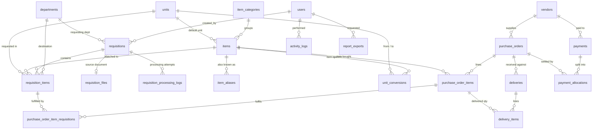

# Database Design

The schema targets MySQL 8.0+ with InnoDB and utf8mb4. All primary keys are `BIGINT UNSIGNED AUTO_INCREMENT`, and every relationship has a foreign key constraint.

Column conventions:

| Kind of value | Column type | Example columns |
|---|---|---|
| Quantity | `DECIMAL(15,3)` | |
| Money amount | `DECIMAL(15,2)` | |
| Unit price | `DECIMAL(15,4)` | |
| Conversion factor | `DECIMAL(18,6)` | |
| Business date | `DATE` (Asia/Dhaka calendar date) | |
| Technical timestamp | `TIMESTAMP` (UTC) | `created_at`, `*_at` |

Statuses are `VARCHAR` backed by PHP enums instead of MySQL `ENUM`, so adding a status needs no table rebuild.

**There are no stored counters or balances.** Every total (requested, purchased, delivered, paid, outstanding) is derived from transaction rows. The only derived values that are stored are MySQL **generated columns**, which the database computes and so cannot drift: `requisition_items.base_quantity` and `purchase_order_items.line_total`.

## ERD

### Key relationships

- **requisition_items ↔ purchase_order_items is many-to-many with quantities** (`purchase_order_item_requisitions`). This is what lets one PO line consolidate "A4 Paper: Req A 10 + Req B 20 = 30", while one requisition line is split across several POs or vendors.
- **deliveries → purchase_orders**. The vendor is reached through the PO and is not copied onto the delivery, so it cannot contradict the PO.
- **payment_allocations** link a vendor payment to that vendor's POs. Unallocated remainder is vendor credit.
- **activity_logs** keep `module` + `record_id` (no FK, no polymorphic relation), so log rows survive and stay readable across all modules.

## Tables

### Authentication & RBAC
| Table | Columns / notes |
|---|---|
| users | id, name, email **UQ**, password (bcrypt), is_active, last_login_at, remember_token, timestamps. Users are deactivated instead of deleted, because audit and FK history references them |
| personal_access_tokens | Sanctum (mobile tokens; hashed) |
| sessions | Redis in runtime; table kept for the database driver fallback |
| roles, permissions, model_has_roles, model_has_permissions, role_has_permissions | spatie/laravel-permission, `guard_name = web` |

### Master data
| Table | Columns | Constraints / indexes |
|---|---|---|
| departments | id, code, name, is_active, timestamps | UQ(code) |
| units | id, code, name, synonyms JSON (e.g. ["pcs","pieces","pc"]), is_active, timestamps | UQ(code) |
| unit_conversions | id, item_id NULL, from_unit_id, to_unit_id, factor, scope_key (generated `IFNULL(item_id,0)`), timestamps | UQ(scope_key, from_unit_id, to_unit_id); CHECK(factor > 0); CHECK(from_unit_id <> to_unit_id). `1 from_unit = factor × to_unit` |
| item_categories | id, code, name, is_active, timestamps | UQ(code) |
| items | id, code, name, normalized_name, sku NULL, category_id NULL, description, default_unit_id, is_active, created_by, timestamps | UQ(code), UQ(normalized_name), UQ(sku), IDX(category_id, is_active) |
| item_aliases | id, item_id, alias, normalized_alias, created_by, timestamps | UQ(normalized_alias). The service also rejects an alias equal to any item's normalized_name |

### Requisitions
| Table | Columns | Constraints / indexes |
|---|---|---|
| requisitions | id, reference_no, external_reference NULL, title, requisition_date NULL, department_id NULL, status, notes, created_by, verified_by/at, approved_by/at, cancelled_by/at, cancellation_reason, timestamps | UQ(reference_no); IDX(status, requisition_date); IDX(created_at); IDX(external_reference); IDX(department_id) |
| requisition_files | id, requisition_id, disk, path, original_name, mime_type, size_bytes, sha256, uploaded_by, timestamps | UQ(requisition_id); **UQ(sha256)**, which blocks duplicate imports |
| requisition_items | id, requisition_id, line_no, item_id NULL, original_name, description, quantity NULL, unit_id NULL, original_unit NULL, conversion_factor NULL, **base_quantity** (generated `ROUND(quantity*conversion_factor,3)` STORED), approved_quantity NULL, requested_date NULL, department_id NULL, notes, match_type NULL, timestamps | IDX(requisition_id, line_no); IDX(item_id); IDX(department_id); CHECK(quantity IS NULL OR quantity >= 0); CHECK(approved_quantity IS NULL OR approved_quantity >= 0) |
| requisition_processing_logs | id, requisition_id, attempt, status, extractor, message, context JSON, started_at, finished_at | IDX(requisition_id, id) |

Requisition statuses: `draft, uploaded, processing, extracted, failed, verified, approved, cancelled`.

### Vendors
| Table | Columns | Constraints |
|---|---|---|
| vendors | id, code, name, contact_person, phone, email, address, company_info, tax_number, is_active, notes, created_by, timestamps | UQ(code); IDX(name) |

### Purchasing
| Table | Columns | Constraints / indexes |
|---|---|---|
| purchase_orders | id, po_number, vendor_id, order_date, purchase_date NULL, status, additional_charges, notes, created_by, submitted_by/at, approved_by/at, purchased_by/at, completed_by/at, cancelled_by/at, cancellation_reason, timestamps | UQ(po_number); IDX(vendor_id, status); IDX(status, purchase_date); IDX(order_date); CHECK(additional_charges >= 0) |
| purchase_order_items | id, purchase_order_id, item_id, ordered_quantity, purchased_quantity NULL, unit_price, discount_amount, tax_amount, **line_total** (generated, STORED), notes, timestamps | UQ(purchase_order_id, item_id); IDX(item_id); CHECKs: ordered > 0, 0 ≤ purchased ≤ ordered, price/discount/tax ≥ 0 |
| purchase_order_item_requisitions | id, purchase_order_item_id, requisition_item_id, ordered_quantity, purchased_quantity NULL, timestamps | UQ(purchase_order_item_id, requisition_item_id); IDX(requisition_item_id); CHECKs as above |

`line_total = ROUND(COALESCE(purchased_quantity, ordered_quantity) * unit_price, 2) - discount_amount + tax_amount`.

PO statuses: `draft, pending_approval, approved, purchased, partially_purchased, completed, cancelled`.

**Invariant**, enforced inside `CreatePurchaseOrder`, `UpdatePurchaseOrder` and `MarkPurchaseOrderPurchased` in one transaction, and checked by `php artisan integrity:check`:

> Σ allocation.ordered_quantity = line.ordered_quantity, and Σ allocation.purchased_quantity = line.purchased_quantity

### Delivery
| Table | Columns | Constraints / indexes |
|---|---|---|
| deliveries | id, delivery_number, purchase_order_id, delivery_date, delivery_reference NULL, received_by NULL, status, notes, created_by, confirmed_by/at, reversed_by/at, reversal_reason, timestamps | UQ(delivery_number); IDX(purchase_order_id, status); IDX(status, delivery_date) |
| delivery_items | id, delivery_id, purchase_order_item_id, quantity, notes, timestamps | UQ(delivery_id, purchase_order_item_id); IDX(purchase_order_item_id); CHECK(quantity > 0) |

Delivery statuses: `pending, confirmed, reversed`.

### Finance
| Table | Columns | Constraints / indexes |
|---|---|---|
| payments | id, payment_reference, vendor_id, payment_date, amount, method, transaction_reference, notes, status, created_by, reversed_by/at, reversal_reason, timestamps | UQ(payment_reference); IDX(vendor_id, status, payment_date); IDX(status, payment_date); CHECK(amount > 0) |
| payment_allocations | id, payment_id, purchase_order_id, amount, created_by, timestamps | IDX(payment_id); IDX(purchase_order_id); CHECK(amount > 0) |

Payment methods: `cash, bank_transfer, mobile_financial_service, cheque, other`. Payment statuses: `active, reversed`.

### System
| Table | Columns | Constraints / indexes |
|---|---|---|
| activity_logs | id, user_id NULL, action, module, record_id NULL, description, old_values JSON, new_values JSON, ip_address, user_agent, created_at | IDX(module, record_id); IDX(user_id, created_at); IDX(created_at); IDX(action) |
| system_settings | id, key, value JSON, updated_by, timestamps | UQ(key) |
| report_exports | id, user_id, report, format, filters JSON, status, file_path, row_count, error, completed_at, expires_at, timestamps | IDX(user_id, created_at) |
| notifications, jobs, job_batches, failed_jobs, cache, cache_locks | Laravel framework tables |

## Derived quantities (single SQL definitions in `app/Queries`)

For each approved requisition line *r*:

| Quantity | Definition |
|---|---|
| requested(r) | `base_quantity` (verified or approved requisitions only) |
| approved(r) | `approved_quantity` (approved requisitions only) |
| on_order(r) | Σ alloc.ordered_quantity where PO.status ∈ {draft, pending_approval, approved} |
| purchased(r) | Σ alloc.purchased_quantity where PO.status ∈ {purchased, partially_purchased, completed} |
| pending(r) | approved − purchased − on_order. This is the cap used when creating POs |
| delivered(r) | FIFO share of the PO line's confirmed delivered quantity: `LEAST(alloc.purchased, GREATEST(0, line_delivered − (running_sum − alloc.purchased)))`, where `running_sum = SUM(alloc.purchased) OVER (PARTITION BY purchase_order_item_id ORDER BY alloc.id)` |

For each PO and vendor:

| Value | Definition |
|---|---|
| PO payable | Σ line_total + additional_charges, when status ∈ {purchased, partially_purchased, completed} |
| PO paid | Σ allocations whose payment.status = active |
| PO due | payable − paid |
| Vendor outstanding | Σ PO payable − Σ PO paid |
| Vendor credit | Σ active payments − Σ their allocations |
